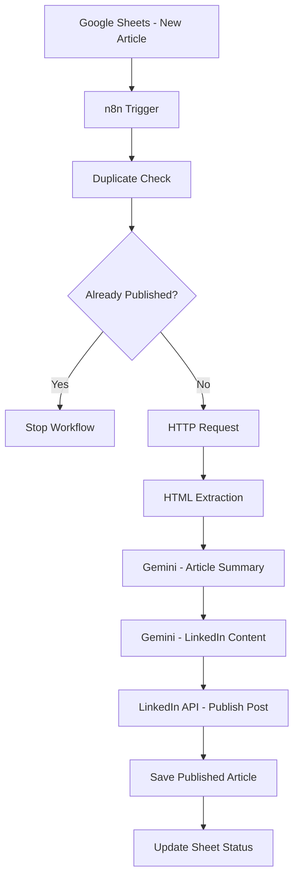

# 🚀 LoopGPT – AI-Powered Social Media Content Automation

  **From Article URL to Automated LinkedIn Post**

LoopGPT is an AI-powered content automation project built using **n8n, Google Gemini, Google Sheets, HTTP Requests, HTML Extraction and the LinkedIn API**.

It automates the process of transforming technology and news article URLs into audience-specific LinkedIn posts and publishing them automatically.

The project explores how AI and workflow automation can work together to reduce repetitive content creation tasks.

---

## 📌 Table of Contents

1. Project Overview
2. Problem Statement
3. Project Objectives
4. Features
5. Technology Stack
6. System Architecture
7. Workflow Execution
8. Google Sheets Structure
9. API and Credentials Setup
10. AI Prompt Engineering
11. Duplicate Detection
12. LinkedIn Publishing
13. Installation and Configuration
14. Testing and Results
15. Challenges and Learnings
16. Limitations
17. Future Enhancements
18. Project Screenshots
19. Author

---

## 1. Project Overview

Creating and publishing social media content manually involves multiple repetitive tasks:

- Finding relevant articles.
- Reading and understanding article content.
- Summarizing important information.
- Writing engaging captions.
- Adapting content for a target audience.
- Publishing posts.
- Maintaining publishing records.

LoopGPT automates this process through an integrated workflow.

A user submits an article URL, topic and target audience through Google Sheets. The workflow retrieves the article, processes its content using Google Gemini, generates a LinkedIn post and publishes it through the LinkedIn API.

The system also checks for duplicate articles and maintains a publishing log.

## 2. Problem Statement

Content creation and publishing can consume considerable time, particularly when technology updates need to be shared regularly.

The objective of LoopGPT is to automate repetitive steps involved in converting online articles into social media content while maintaining audience relevance and avoiding duplicate publishing.

## 3. Project Objectives

- Automate article submission and processing.
- Extract relevant information from article webpages.
- Use AI to summarize article content.
- Generate audience-specific LinkedIn posts.
- Prevent duplicate article publishing.
- Automate LinkedIn post creation.
- Maintain publishing records using Google Sheets.

## 4. Key Features

| Feature | Description |
|---|---|
| Article submission | Accepts article URLs through Google Sheets |
| Automatic triggering | Starts when a new input row is added |
| Article extraction | Retrieves webpage content |
| AI summarization | Uses Google Gemini |
| Content generation | Creates audience-specific LinkedIn posts |
| Duplicate detection | Checks previously published URLs |
| Automatic publishing | Publishes through LinkedIn API |
| Publishing records | Stores post details and status |

## 5. Technology Stack

| Technology | Purpose |
|---|---|
| n8n | Workflow automation and orchestration |
| Google Gemini | Article summarization and content generation |
| Google Sheets | Input management and publishing records |
| HTTP Request | Retrieving article webpages |
| HTML Extraction | Extracting article titles, descriptions and text |
| LinkedIn API | Publishing generated posts |

## 6. System Architecture

## 7. Workflow Execution

### Step 1: Submit an article

A new row is added to Google Sheets with:

- Article_URL
- Topic
- Target_Audience
- Status

The status is initially set to `New`.

### Step 2: Google Sheets Trigger

The n8n Google Sheets Trigger monitors the input sheet for newly added rows.

The workflow starts when a new row is detected.

### Step 3: Duplicate Detection

The workflow searches the publishing log in Sheet2 using the submitted article URL.

If the URL already exists, the workflow stops.

If the URL is not found, processing continues.

### Step 4: HTTP Request

The HTTP Request node retrieves the webpage associated with the article URL.

It requests the webpage and passes the returned HTML content to the next node.

### Step 5: HTML Extraction

The HTML node extracts relevant webpage information, including:

- Article title
- Article description
- Article paragraphs

The extracted information is passed to the AI summarization stage.

### Step 6: Article Summarization

A Basic LLM Chain connected to Google Gemini processes the extracted article content.

It produces a concise summary containing the important information from the article.

### Step 7: LinkedIn Content Generation

Another Basic LLM Chain connected to Google Gemini generates a LinkedIn post using:

- Article summary
- Selected topic
- Target audience

The prompt guides the model to create readable, relevant LinkedIn content.

### Step 8: LinkedIn Publishing

The LinkedIn node creates a post using the generated content.

The post is published through the connected LinkedIn account.

### Step 9: Save Published Article

The workflow appends the article URL, LinkedIn post ID and publishing timestamp to Sheet2.

This log is used for duplicate detection in future executions.

### Step 10: Update Input Status

The workflow updates the original row in Sheet1.

The status changes to `Posted`.

## 8. Google Sheets Structure

### Sheet1 – Input Sheet

| Article_URL | Topic | Target_Audience | Status |
|---|---|---|---|
| Article webpage URL | Artificial Intelligence | AI Engineers | New / Posted |

### Sheet2 – Published Article Log

| Article_URL | Post_ID | Posted_At |
|---|---|---|
| Published article URL | LinkedIn post identifier | Publishing timestamp |

## 9. API and Credentials Setup

This project connects multiple external services using their respective integrations and authentication credentials.

The exact account setup, credential creation, permission scopes, callback URLs and configuration steps are documented separately in:

`docs/03-api-and-credentials-setup.md`

**Security:** API keys, OAuth client secrets, access tokens and passwords must never be uploaded to this repository.

## 10. AI Prompt Engineering

Google Gemini is used for two different tasks:

**Article summarization**
- Understand extracted article content.
- Identify important facts and key developments.
- Produce a concise and informative summary.

**LinkedIn content generation**
- Use the generated summary.
- Consider the selected topic and target audience.
- Generate an engaging professional post.
- Use readable formatting and relevant hashtags.
- Avoid Markdown formatting that is unsuitable for LinkedIn publishing.

The actual prompts used in the workflow will be documented in `docs/06-ai-prompts.md`.

## 11. Duplicate Detection

Before processing a new article, the workflow checks the published article log.

This helps prevent the same article URL from being published repeatedly.

The duplicate-check logic is implemented using Google Sheets and an IF node in n8n.

## 12. LinkedIn Publishing

The generated LinkedIn content is passed to the configured LinkedIn publishing node.

The workflow records the returned post identifier and publishing timestamp in Google Sheets.

Publishing requires an authorized LinkedIn connection and the necessary API permissions.

## 13. Installation and Configuration

The exported n8n workflow can be imported into another n8n instance.

A user recreating this project will need to:

1. Create or access an n8n instance.
2. Set up the required Google Sheets document and worksheets.
3. Configure Google Sheets authentication.
4. Configure Google Gemini access.
5. Configure LinkedIn authentication and publishing permissions.
6. Import the workflow JSON.
7. Assign the appropriate credentials to the workflow nodes.
8. Verify spreadsheet mappings and node expressions.
9. Test with a new article URL.
10. Activate the workflow after testing.

Detailed setup instructions are provided in the `docs` directory.

## 14. Testing and Results

Testing should verify:

- New article rows trigger the workflow.
- Article content is retrieved successfully.
- HTML extraction returns usable content.
- Gemini generates a relevant summary.
- Gemini generates the LinkedIn post.
- Duplicate URLs are blocked.
- LinkedIn publishing succeeds.
- The published article is logged.
- The original row is updated to `Posted`.

Screenshots and execution evidence are available in the `screenshots` directory.

## 15. Challenges and Learnings

During development, the project provided practical experience with:

- Connecting external services.
- Configuring OAuth-based credentials.
- Mapping data between workflow nodes.
- Retrieving and extracting webpage content.
- Designing AI prompts.
- Handling conditional execution paths.
- Debugging HTTP and workflow errors.
- Tracking published records.
- Testing end-to-end automation.

## 16. Limitations

- Article extraction depends on webpage accessibility and HTML structure.
- Some websites may block automated requests.
- AI-generated summaries and captions require quality checks.
- LinkedIn publishing depends on account authorization and API permissions.
- The current implementation focuses on text-based LinkedIn publishing.
- The workflow requires an active n8n instance to execute.

## 17. Future Enhancements

Potential future improvements include:

- AI-generated images for LinkedIn posts.
- Manual approval before publishing.
- Multi-platform publishing.
- Scheduled content publication.
- A dedicated dashboard.
- Publishing analytics and reporting.
- Improved retry and error-handling mechanisms.

## 18. Project Screenshots

The following screenshots will document the actual implementation:

- Complete n8n workflow.
- Google Sheets input.
- Duplicate detection.
- Gemini-generated summary.
- Generated LinkedIn content.
- Successful workflow execution.
- Published LinkedIn post.
- Updated Google Sheets publishing log.

## 19. Author

**Deepika More**

B.Tech – Computer Engineering

Project: LoopGPT – AI-Powered Social Media Content Automation

Built as a hands-on learning project to explore AI integration, API communication and workflow automation.

---

**Learning by building. Automating by connecting.** 🚀
